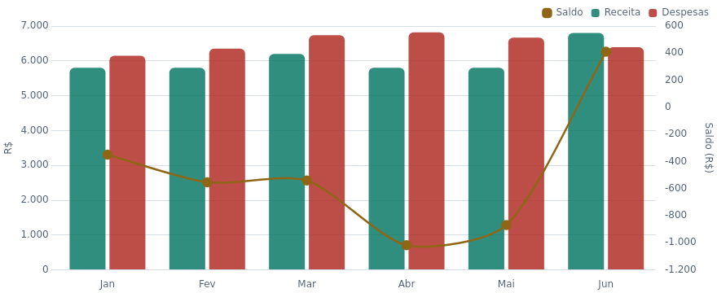

# Automação com IA

**Três projetos práticos de automação com Claude Cowork: organizar documentos, transformar conteúdos e analisar finanças.**
**[▶ Ver o painel financeiro ao vivo](https://brumo97.github.io/automacao-com-ia/projetos/agente-financeiro/painel/index.html)**



## Apresentação

Este repositório reúne o trabalho que desenvolvi ao aprender a automatizar tarefas com inteligência artificial. Cada projeto parte de arquivos reais de trabalho (atas, contratos, relatórios, planilhas) e chega a uma entrega concreta: resumos, listas de ações, roteiros de slides, relatórios financeiros e um painel interativo.

O material está completo, não resumido: instruções dadas à IA, skills, arquivos de entrada, resultados intermediários, versões sucessivas das entregas e o código do painel.

## Objetivo e contexto

- Aprender a estruturar instruções para agentes de IA (`CLAUDE.md`, skills) e encadear etapas em um fluxo.
- Aplicar a automação a casos de uso concretos: produtividade, documentação e análise de dados.
- Documentar o processo de forma verificável, com entradas, regras e resultados lado a lado.

Os projetos foram desenvolvidos com o apoio do Claude (Anthropic), usado como ferramenta de trabalho e de aprendizagem. Eu defini os objetivos, as regras, a organização e as revisões; parte do texto e do código foi gerada com assistência da IA e revisada por mim. O projeto Transforma Docs parte de um exercício da formação Cowork da Hashtag Programação.

## Tecnologias e ferramentas

| Área | Ferramentas |
|---|---|
| Agentes de IA | Claude Cowork, arquivos `CLAUDE.md`, skills (`SKILL.md`) |
| Dados | Planilha Excel no Google Drive, CSV e JSON |
| Painel | HTML, CSS e JavaScript puros, Chart.js 4.4.1 |
| Scripts | Python 3 (geração do painel e validação dos dados, sem dependências externas) |
| Documentos | Word (.docx), Markdown, PDF |

## Os três projetos

| Projeto | O que faz | Destaques |
|---|---|---|
| [Assistente de produtividade](projetos/assistente-produtividade/) | Organiza arquivos por assunto e extrai o essencial de cada documento | 2 skills, 7 arquivos de entrada (6 textos e 1 imagem), resumos individuais e visão geral |
| [Transforma Docs](projetos/transforma-docs/) | Converte um documento em outro formato: resumo executivo, lista de ações, roteiro de slides, post | 4 documentos Word, 1 skill, versões v1 a v3 dos resultados |
| [Agente financeiro](projetos/agente-financeiro/) | Lê uma planilha de finanças, aplica regras de alerta e gera relatórios e um painel | `CLAUDE.md` com regras de análise, 3 relatórios, painel interativo PT/EN |

### Assistente de produtividade

Duas skills dividem o trabalho: `organizador-de-arquivos` propõe um plano de classificação antes de mover qualquer arquivo, e `processador-de-documentos` resume um arquivo e salva o resultado em `saidas/`. Compare cada documento em `entrada/` com seu resumo correspondente.

### Transforma Docs

Uma skill (`doc-transformer`) e um `CLAUDE.md` com regras de formato e de economia de tokens. As versões sucessivas dos resultados foram mantidas para mostrar a evolução das entregas.

### Agente financeiro

Fluxo em três etapas (leitor → analisador → relatório) descrito no `CLAUDE.md`, com regras explícitas: alerta quando um gasto supera em 20% a média dos três meses anteriores, mês negativo quando o saldo é menor que zero, meta de poupança acima de 20% da renda.

O painel tem seis abas (case, visão geral, categorias, lançamentos, diagnóstico, método), filtros por mês e categoria, tema claro e escuro, seletor de idioma português/inglês e funciona offline em um único arquivo HTML.

## Estrutura de diretórios

```
automacao-com-ia/
├── README.md
├── ORGANIZACAO.md                      correspondência com as pastas de estudo e auditoria
└── projetos/
    ├── assistente-produtividade/
    │   ├── entrada/                    documentos organizados por assunto
    │   ├── saidas/                     resumos e visão geral
    │   └── skills/                     organizador-de-arquivos, processador-de-documentos
    ├── transforma-docs/
    │   ├── CLAUDE.md
    │   ├── arquivos-testes/            4 documentos Word
    │   ├── resultados/                 entregas e versões
    │   └── skills/doc-transformer/
    └── agente-financeiro/
        ├── CLAUDE.md                   contexto, regras de análise e fluxo
        ├── saidas/                     relatórios gerados
        └── painel/
            ├── index.html              painel pronto (arquivo único)
            ├── src/                    HTML, CSS e JS separados
            ├── data/                   lançamentos em CSV e JSON
            ├── scripts/                build.py, validar_dados.py
            ├── relatorios/             relatórios HTML
            ├── docs/imagens/           capturas dos gráficos
            └── vendor/                 Chart.js e licença
```

## O que aprendi

- Escrever instruções precisas para um agente: contexto, papel, regras e limites de comportamento.
- Dividir um processo em skills com uma única função cada e encadeá-las em ordem fixa.
- Tratar dados com cuidado: formato numérico, linhas de total, classificações inconsistentes (ex.: um serviço de streaming classificado em Lazer, e não em Assinaturas).
- Validar os resultados com um script independente em vez de confiar apenas na saída da IA.
- Versionar entregas e documentar o que ainda não está pronto.

## Como explorar

**Sem instalar nada**

- Leia um documento de entrada e compare com o resultado correspondente. Bons pontos de partida: [visão geral dos documentos](projetos/assistente-produtividade/saidas/visao_geral_documentos.txt), [resumo do projeto e-learning](projetos/transforma-docs/resultados/resumo-projeto-elearning-v2.md) e [relatório financeiro completo](projetos/agente-financeiro/saidas/relatorio-financeiro_jan-jun-2024_fluxo-completo_2026-11-08.md).
- Para ver o painel, baixe o repositório (botão **Code → Download ZIP**), extraia e abra `projetos/agente-financeiro/painel/index.html` no navegador.

**Para reconstruir o painel** (Python 3):

```bash
cd projetos/agente-financeiro/painel
python scripts/build.py          # gera index.html e data/data.js a partir de src/ e data/
python scripts/validar_dados.py  # confere o CSV contra os totais da planilha original
```

**Para repetir os fluxos no Claude Cowork:** abra a pasta do projeto como área de trabalho e instale as skills pelo mecanismo da própria ferramenta (os arquivos no repositório não são instalados automaticamente).

### Limites atuais

- As três skills financeiras e a planilha Excel original não estão incluídas: o painel funciona com os dados do repositório, mas o fluxo Cowork financeiro completo não é reproduzível só com este material.
- No `CLAUDE.md` do agente financeiro, o identificador do Google Drive foi substituído por `ID_DE_VOTRE_FICHIER_DRIVE`.
- Ainda não há demonstração online publicada.

Detalhes da organização e da auditoria de segurança em [ORGANIZACAO.md](ORGANIZACAO.md).

## Aviso sobre os dados

Todos os dados financeiros usados nos exercícios são **fictícios**. Os documentos de exemplo (atas, contratos, briefings, relatórios) também usam pessoas, empresas e contatos fictícios. Os relatórios e o painel descrevem esses dados e não constituem recomendação financeira.

## Autor

**Bruno Moreau** · [github.com/brumo97](https://github.com/brumo97)
