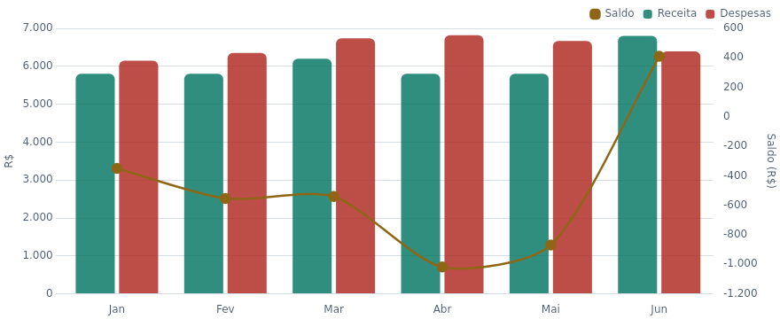

# Agente financeiro

Da planilha ao diagnóstico: leitura dos dados, análise de gastos, relatórios e painel interativo.

| Parte do trabalho | Conteúdo |
|---|---|
| Instruções | [CLAUDE.md](CLAUDE.md), com contexto, regras e fluxo previsto |
| Relatórios do agente | [saidas/](saidas/), com três entregas preservadas |
| Painel e código | [painel/](painel/), com filtros, gráficos e diagnósticos |
| Dados incluídos | [CSV dos lançamentos](painel/data/lancamentos.csv), JSON e JavaScript gerados |
| Validação | [Script Python](painel/scripts/validar_dados.py) |

## O que os dados mostram

> Os dados financeiros deste projeto são fictícios, criados para fins de exercício.

- Em 5 dos 6 meses, as despesas superaram as receitas.
- Saldo do semestre: **−R$ 2.920,83**.
- Base incluída: **203 lançamentos**, de janeiro a junho de 2024.

[Consultar o relatório do fluxo completo](saidas/relatorio-financeiro_jan-jun-2024_fluxo-completo_2026-11-08.md)

## Como consultar

Abra `painel/index.html` no navegador. Para editar ou reconstruir o painel, consulte o [README técnico](painel/README.md).

O fluxo documentado é: leitor-financeiro → analisador-financeiro → relatorio-financeiro. Os relatórios registram entregas desse processo, mas os arquivos das três skills não foram incluídos no material recebido. Não foram recriados nem apresentados como existentes nesta preparação.

## O que falta para reproduzir o fluxo Cowork

- Exportar as três skills financeiras e documentar sua instalação.
- Disponibilizar a planilha Excel original ou adaptar as instruções para o CSV incluído. No `CLAUDE.md`, o identificador do arquivo no Google Drive foi substituído pelo marcador `ID_DE_VOTRE_FICHIER_DRIVE`; para repetir o fluxo, informe ali o ID da sua própria cópia da planilha.
- Definir a frequência da automação, que permanece como campo a preencher no documento original.

Os relatórios HTML e partes da interface registram um estágio anterior do projeto e podem indicar que a terceira skill ainda não existia. São artefatos preservados, não uma confirmação do estado atual da configuração no Cowork.

[Voltar à apresentação](../../README.md)
