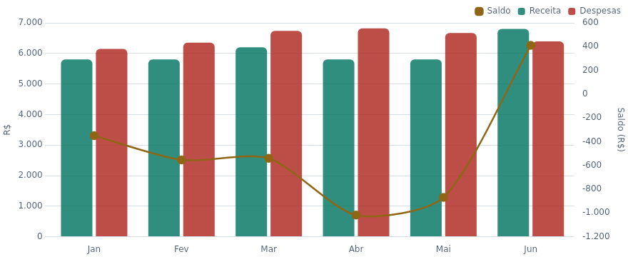
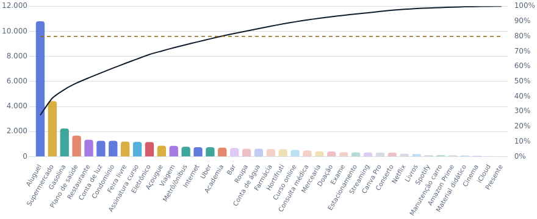
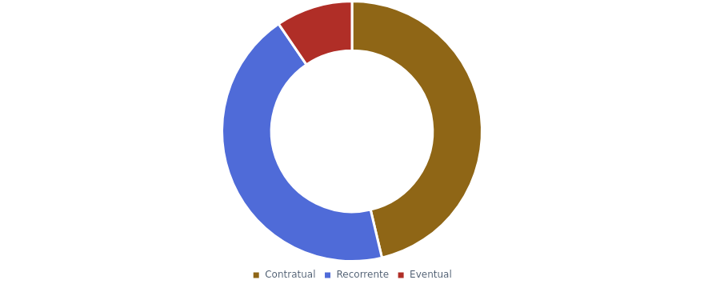
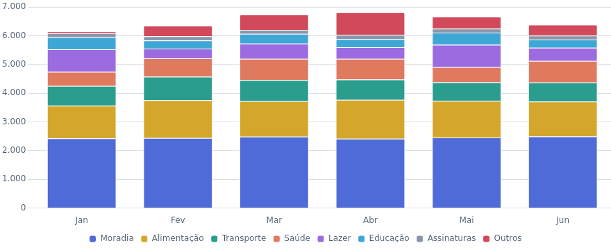
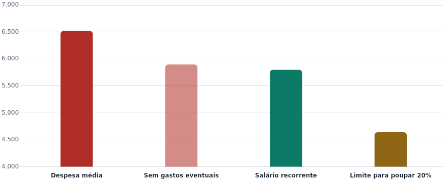

# Agente Financeiro · Painel analítico

Um agente que transforma uma planilha de finanças pessoais em diagnóstico: lê os lançamentos, resume cada mês, aplica regras de alerta e entrega um painel interativo com o que aconteceu, o que está fora do padrão e onde agir.

> **EN:** A finance agent that turns a personal-finance spreadsheet into an interactive diagnosis dashboard. The interface is available in Portuguese and English (toggle at the top).



## O case

| | |
|---|---|
| **Entra** | Planilha de receitas e despesas (`data/lancamentos.csv`) |
| **Processa** | 3 skills em sequência |
| **Sai** | Perfil, alertas e onde agir |

O fluxo do agente é dividido em skills, cada uma com uma única função:

1. **leitor-financeiro**: organiza os dados e monta o perfil de cada mês e categoria.
2. **analisador-financeiro**: aplica as regras de alerta e aponta tendências e pontos positivos.
3. **relatorio-financeiro**: apresenta o resultado. O arquivo da skill não está incluído neste repositório; este painel também apresenta os resultados.

## O que o painel mostra

- **O case:** para que serve, o que faz e como proceder.
- **Visão geral:** conclusão principal, KPIs com minigráficos, receita × despesas × saldo, poupança contra a meta de 20% e para onde vai o dinheiro.
- **Categorias:** composição mês a mês (R$ ou %), mapa de desvios contra a média e raio-X de cada categoria.
- **Lançamentos:** Pareto dos gastos, divisão fixo × recorrente × eventual, concentração por dia do mês e tabela pesquisável dos 197 lançamentos.
- **Diagnóstico:** alertas pelas regras do projeto, déficit estrutural, instabilidade por item e qualidade dos dados.
- **Método:** definição de cada termo usado.

Filtros globais por mês e categoria, gráficos clicáveis, tema claro e escuro, seletor de idioma (PT/EN), layout responsivo e impressão.

## Principais achados (dados de jan a jun 2024)

- O déficit é estrutural: **90,5%** do gasto se repete todo mês.
- **5 de 6** meses tiveram despesa acima da receita; saldo do semestre de **−R$ 2.920,83**.
- Os itens contratuais custam **R$ 3.018,94/mês**, 52% do salário recorrente.
- **16 de 39** itens concentram 80% do gasto.

| | |
|---|---|
|  |  |
|  |  |

## Como usar

**Ver o painel:** abra `index.html` no navegador. É um arquivo único com tudo embutido e funciona sem internet.

**Publicação:** este painel agora fica em `projetos/agente-financeiro/painel/`. O pacote ainda não configura uma página inicial na raiz nem um workflow de publicação. A demonstração será configurada ao publicar o repositório; por enquanto, abra o HTML localmente.

**Editar o código:** trabalhe em `src/` (HTML, CSS e JS separados) e gere a versão final:

```bash
python scripts/build.py          # gera index.html e data/data.js a partir de src/, data/ e vendor/
python scripts/validar_dados.py  # confere o CSV contra os totais da planilha original
```

Para testar `src/index.html` direto, rode `build.py` antes (ele gera `data/data.js`).

## Estrutura

```
painel/
├── index.html                  painel pronto (gerado pelo build)
├── src/
│   ├── index.html              estrutura da página
│   ├── css/styles.css          estilos, temas e responsividade
│   └── js/app.js               lógica, gráficos, filtros e traduções
├── data/
│   ├── lancamentos.csv         fonte dos dados (203 lançamentos)
│   ├── lancamentos.json        mesmos dados em JSON (gerado)
│   └── data.js                 dados no formato do painel (gerado)
├── vendor/
│   ├── chart.umd.js            Chart.js 4.4.1
│   └── LICENSE-chartjs.md
├── scripts/
│   ├── build.py                monta o index.html de arquivo único
│   └── validar_dados.py        checagem dos dados contra a planilha
├── relatorios/                 versões anteriores em HTML (relatório completo, resumo, mapa do projeto)
└── docs/imagens/               imagens usadas neste README
```

## Dados e limites

- Fonte: planilha `financas_pessoais_2024.xlsx` (abas Lançamentos, Resumo Mensal e Gastos por Categoria). As 48 combinações de categoria e mês conferem ao centavo com as abas de resumo.
- Período curto (6 meses) e de 2024: tendências têm pouca base estatística.
- Os dados são fictícios, criados para o exercício. O painel descreve a planilha e não é recomendação financeira.

## Tecnologias

HTML, CSS e JavaScript puros, sem framework. Gráficos com [Chart.js](https://www.chartjs.org/) 4.4.1 (licença MIT). Scripts de build e validação em Python 3, sem dependências externas.

## Ajustes de responsividade

- Cabeçalho reorganizado em celulares estreitos e filtros recolhíveis até 1180 px.
- Botões com altura mínima de 44 px e busca com fonte de 16 px.
- Cartões, valores e alertas adaptados a telas pequenas.
- Tabelas com rolagem própria e foco por teclado. Pareto com largura proporcional à quantidade de itens.
- Altura do cabeçalho acompanhada automaticamente; em paisagem com pouca altura, ele acompanha a rolagem.
- Fontes em src/ e index.html autônomo atualizados.

Validação: build concluído, sintaxe JavaScript verificada e 203 lançamentos conferidos pelo script original. A validação visual em navegador não foi concluída porque o ambiente bloqueou a inicialização do Chromium. Conferir as seis abas em 320, 375, 768, 1024 e 1440 px, nos dois idiomas, incluindo filtros, busca, tema e rotação. Os relatórios HTML separados não foram alterados.

[Ver o projeto financeiro completo](../README.md) · [Voltar à apresentação geral](../../../README.md)
